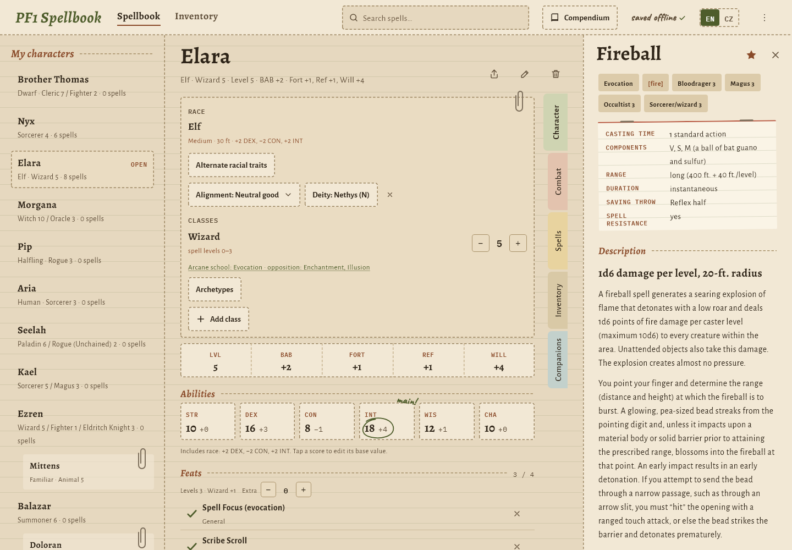
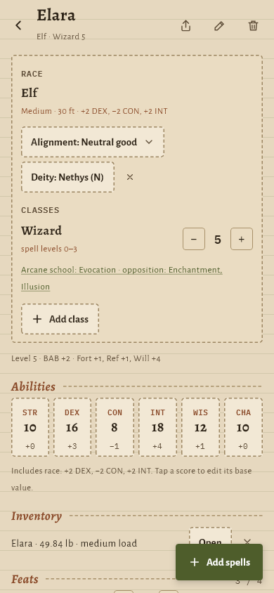
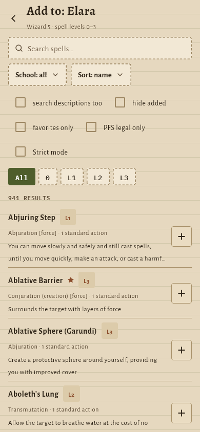
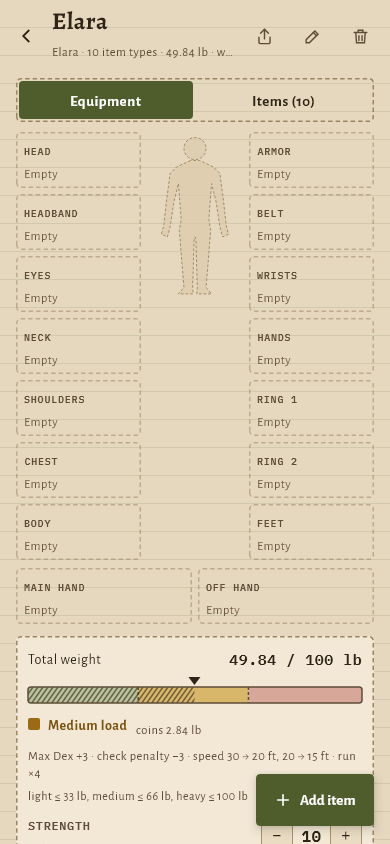

# PF1 Spellbook

**English** | [Čeština](README.cs.md)

[](https://github.com/DejvHeHe/pathfinder-mobile-app/actions/workflows/ci.yml)
[](https://github.com/DejvHeHe/pathfinder-mobile-app/releases)
[](LICENSE)


A free, open-source, **offline companion app for Pathfinder 1e players**. Build characters with a spellbook, skills and
feats – the app checks feat prerequisites for you – and keep track of your inventory, coins and carrying capacity.

No account, no server, no ads: everything stays on your device. One shared Kotlin Multiplatform + Compose Multiplatform
codebase runs on **Android, iOS, desktop (Windows, macOS, Linux) and in the browser** (Kotlin/Wasm).

<p>
  
</p>
<p>
  
  
  
</p>

## Features

- **Characters** – 80 races (ability modifiers, size), 49 classes with multiclassing (BAB, saves), alignment and
  463 deities; subclasses: cleric domains and subdomains of your deity, druid Nature Bond, oracle mysteries,
  sorcerer bloodlines, wizard schools.
- **Spellbook** – 3,030 spells; the picker offers only spells your class can cast at its level. Spells per day and spells
  known from the class tables, bonus slots from your casting ability, domain/school slots, and a **game mode** for the table
  (cast, track slots, rest).
- **Skills** – ranks, class skills, skill points, totals with ability and racial bonuses.
- **Feats** – 3,442 feats with **automatic prerequisite checks** (abilities, BAB, skills, class features, race, alignment,
  deity, proficiencies, spellcasting…) shown as ✓ / ✗ / ?; anything the app can't verify you confirm once by hand.
- **Limited-use abilities** – Smite Evil, Rage, Ki Pool… with uses per day by level, plus custom counters.
- **Inventory** – ~6,060 items, your own item catalog, potions / scrolls / wands priced from spells, coins,
  carrying capacity with load penalties, and hidden prices for expensive loot (tap 10× to reveal).
- **Export / import** of characters, feats and inventories as readable JSON – share them with your party.
- **Up-to-date data** – spell and item databases can be re-downloaded from their sources with one tap.
- **English and Czech** UI, a hand-drawn "ruled notebook" design, phone and three-column desktop layouts.

> **AI-first / vibe-coded project.** Nearly all of the code, data tooling and documentation was written by an AI
> ([Claude Code](https://claude.com/claude-code) by Anthropic) – the author designed the app, steered every feature,
> reviewed and tested the results on real devices. Commits written with the AI carry a `Co-Authored-By: Claude` trailer.
> Bug reports are very welcome – some PF1 rule edge cases may still be off.

## Privacy

The app collects **no personal data** – no account, no tracking, no ads. Your characters and inventories stay on your
device (or in your browser) and leave it only when you export them. It works fully offline and goes online only when you
tap to download an updated spell or item database. The hosted web version may count anonymous visits and
app actions (cookie-less Umami – only the kind of action, never your data). Details in the app under menu → **About & licenses**.

## Download

| Platform | How |
|---|---|
| Android | `.apk` from [Releases](https://github.com/DejvHeHe/pathfinder-mobile-app/releases) |
| Windows / macOS / Linux | `.msi` / `.dmg` / `.deb` from [Releases](https://github.com/DejvHeHe/pathfinder-mobile-app/releases) (Java included) |
| Web | `-web.zip` from Releases for any static hosting, or Docker: `docker compose pull && docker compose up -d` ([guide](docs/en/deploy.md)) |
| iOS | build it yourself with Xcode and a free Apple ID ([guide](docs/en/ios-install.md)), or use the web version in Safari |

## Building from source

Requires JDK 17+ (21 recommended); the Android SDK only for Android, a Mac with Xcode only for iOS.

```bash
git clone https://github.com/DejvHeHe/pathfinder-mobile-app.git
cd pathfinder-mobile-app
./gradlew :composeApp:run                              # desktop
./gradlew :composeApp:installDebug                     # Android (connected phone / emulator)
./gradlew :composeApp:wasmJsBrowserDevelopmentRun      # web on http://localhost:8080
./gradlew :composeApp:desktopTest                      # tests
```

More in [docs/en/build.md](docs/en/build.md).

## Tech stack

Kotlin 2.1 · Compose Multiplatform 1.7 (Material 3) · kotlinx-serialization · kotlinx-coroutines ·
multiplatform-settings · Ktor client · Kotlin/Wasm for the web · GitHub Actions for releases and the Docker image.

```
composeApp/src/commonMain/   shared data, rules and UI (≈ everything)
composeApp/src/{android,ios,desktop,wasmJs}Main/   platform bits: files, HTTP client, file dialogs, entry points
iosApp/                      Xcode wrapper
tools/                       Python scripts that build the bundled data
docs/                        documentation (Czech) – docs/en/ in English
```

## Documentation

| Document | About |
|---|---|
| [User guide](docs/en/user-guide.md) | how to use the app: characters, spells, skills, feats, inventory, export |
| [Architecture](docs/en/architecture.md) | state, navigation, UI, persistence, platforms, tests |
| [Data](docs/en/data.md) | data sources and formats, PF1 rules implemented in code |
| [Build](docs/en/build.md) | building each platform, design previews, regenerating data |
| [Deploy](docs/en/deploy.md) | releases (CI), APK signing, web in Docker behind your own nginx |
| [iOS install](docs/en/ios-install.md) | putting the app on your own iPhone with Xcode |

## Contributing

Bug reports, ideas and pull requests are welcome – see [CONTRIBUTING.md](CONTRIBUTING.md).
Planned work is tracked in [TODO.md](TODO.md) (in Czech – feel free to ask in an issue).

## Data sources and credits

- Spells: [SpellTable-pf1e](https://github.com/iociveteres/SpellTable-pf1e) (MIT), data from [Archives of Nethys](https://aonprd.com)
- Feats, deities, spell slot tables: [Archives of Nethys](https://aonprd.com)
- Classes, races, mundane gear: the [Pathfinder 1e system for Foundry VTT](https://gitlab.com/foundryvtt_pathfinder1e/foundryvtt-pathfinder1) (GPL-3.0, content OGL)
- Weapons and magic items: [Vireche/randomitemgenerator](https://github.com/Vireche/randomitemgenerator) (d20pfsrd)
- Fonts: Alegreya, Alegreya Sans, IBM Plex Mono (SIL OFL)

Full list, the OGL text with Section 15 and library licenses: [NOTICE.md](NOTICE.md) (also in the app under menu → **About & licenses**).

## License

Copyright (C) 2026 David Sobíšek. The source code is licensed under the **GNU GPL v3** – see [LICENSE](LICENSE).

The game content (spells, feats, items…) is **not** under the GPL – it remains under the Open Game License v1.0a and the
Paizo Community Use Policy, which is why the app is free and must never be charged for.

*This app uses trademarks and/or copyrights owned by Paizo Inc., used under Paizo's Community Use Policy
([paizo.com/licenses/communityuse](https://paizo.com/licenses/communityuse)). We are expressly prohibited from charging you
to use or access this content. This app is not published, endorsed, or specifically approved by Paizo.
For more information about Paizo Inc. and Paizo products, visit [paizo.com](https://paizo.com).*
