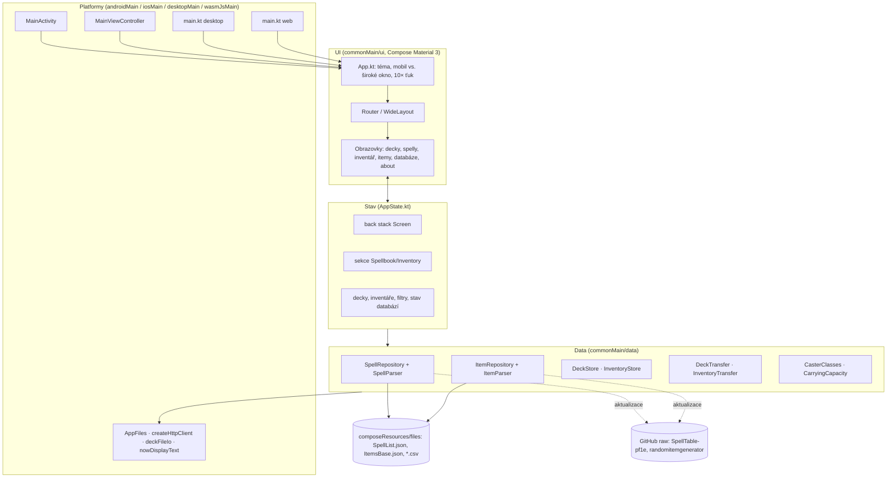

# Architektura

## Přehled

Jedna Kotlin Multiplatform aplikace (`composeApp`). Téměř všechno – data, logika i UI – je ve `commonMain`
a sdílí se mezi Androidem, iOS, desktopem a webem. Platformní kód řeší jen soubory, HTTP klient, dialogy pro soubory
a vstupní bod appky.



## Stack

| Co | Verze / knihovna |
|---|---|
| Jazyk, build | Kotlin 2.1.0, Gradle 8.10.2, AGP 8.7.3 |
| UI | Compose Multiplatform 1.7.3, Material 3, `material-icons-core` |
| Data | kotlinx-serialization-json 1.7.3, kotlinx-coroutines 1.9.0 |
| Úložiště | multiplatform-settings 1.3.0 (postavy, inventáře) + vlastní `AppFiles` (velké soubory) |
| Síť | Ktor 3.0.3 (OkHttp na Androidu/desktopu, Darwin na iOS, Js na webu) |
| Targety | `androidTarget`, `jvm("desktop")`, `iosX64`, `iosArm64`, `iosSimulatorArm64` (framework `ComposeApp`), `wasmJs` (web) |

Verze jsou v `gradle/libs.versions.toml`.

## Struktura kódu

```
composeApp/src/
  commonMain/kotlin/cz/pfspells/
    App.kt                    téma, přepnutí mobil/široké okno, detektor 10 ťuknutí, Router
    AppState.kt               veškerý stav appky + navigace (Screen, Section, filtry, ItemDbState, jazyk…)
    Strings.kt                texty UI v angličtině a češtině (Strings, EnStrings, CsStrings, Lang)
    data/
      Model.kt                Spell, Deck (jen migrace a starý export)
      Character.kt            Character, ClassEntry, Abilities, FeatPick, Tracker, Spellbook, CharacterStore (+ migrace decků)
      CasterClasses.kt        27 sesílacích class, progrese, CastingKind, sloty (LevelSlots, bonusSpells)
      CastingTable.kt         GENEROVANÉ: spells per day / known (AoN, tools/build_casting.py)
      ClassInfo.kt            ClassInfo (BAB, záchrany, HD), ClassCatalog, Character.stats()
      ClassTable.kt           GENEROVANÉ: 49 class (Foundry, tools/build_classes.py)
      ClassFeatures.kt        FeaturePresets (Smite Evil, Rage…), Character.resources()
      Subclasses.kt           domény, mystéria, bloodline, školy – SubclassIndex, bonusová kouzla
      Feats.kt                Feat, FeatDatabase, FeatRepository, FeatPrereqs, featSlots
      CharacterTransfer.kt    export/import postav a featů (+ starých decků)
      CustomItems.kt          vlastní katalog itemů, lektvary/svitky/hůlky ze spellů (SpellItemKind)
      SpellParser.kt          SpellList.json → Spell
      Repositories.kt         SpellRepository, DeckStore (migrace), SpellDatabase
      DeckTransfer.kt         starý formát decků (import), ImportError
      Items.kt                Item, ItemCategory, ItemDatabase, Inventory, InvEntry, CarryingCapacity
      ItemParser.kt           ItemsBase.json + CSV → Item; CSV parser; decodeText
      ItemRepository.kt       ItemRepository, InventoryStore, InventoryTransfer
      Platform.kt             expect: AppFiles, createHttpClient, deckFileIo, nowDisplayText
    ui/
      Theme.kt                barvy Nb.*, fonty, PfTheme, modifikátory (linkovaný papír, čárkované okraje), ikony
      Common.kt               společné komponenty + NbScreen (kostra obrazovky)
      WideLayout.kt           třísloupcové rozložení
      DeckListScreen.kt       úvod (záložky), seznam postav, menu ⋮, nová postava
      DeckDetailScreen.kt     detail postavy: classy, atributy, inventář, featy, schopnosti, kouzla po classách, herní režim
      ClassPicker.kt          výběr classy (karty, hledání, náhled)
      SubclassUi.kt           výběr podtřídy, bonusová kouzla podtřídy
      FeatScreens.kt          featy postavy, výběr a detail featu
      ResourcesUi.kt          schopnosti s počtem použití, vlastní počítadla
      SpellBrowserScreen.kt   výběr spellů pro classu postavy + kompendium
      SpellDetailScreen.kt    detail spellu
      InventoryCommon.kt      formátování cen/váhy, skryté ceny, mince, zatížení, záložky
      InventoryScreen.kt      seznam a detail inventáře, boční panel
      ItemScreens.kt          výběr itemu, detail itemu/položky, vlastní item
      DeckTransferDialogs.kt  export/import dialogy (postavy, featy, inventáře)
      DatabaseScreen.kt       stav a aktualizace databází
      AboutScreen.kt          About & licenses (GPL, Paizo CUP, text OGL)
    composeResources/
      files/                  přibalená data (viz docs/data.md)
      font/                   Alegreya, Alegreya Sans, IBM Plex Mono
  androidMain/   MainActivity, AndroidManifest, Platform.android.kt, DeckFileIo.android.kt
  desktopMain/   main.kt (okno 1360×880, Esc = zpět), Platform.desktop.kt, DeckFileIo.desktop.kt
  iosMain/       MainViewController.kt, Platform.ios.kt, DeckFileIo.ios.kt
  wasmJsMain/    main.kt (ComposeViewport), Platform.wasmJs.kt (IndexedDB, Ktor Js, stažení/výběr souboru), resources/index.html
  commonTest/, desktopTest/   testy + PreviewRender (náhledy obrazovek do PNG)
iosApp/          Xcode projekt (SwiftUI obal kolem ComposeApp)
tools/build_items.py   sestavení přibalené databáze itemů
tools/build_feats.py, build_casting.py, build_classes.py   featy (AoN), tabulky slotů (AoN), classy (Foundry)
```

## Stav a navigace

Celá appka má **jeden objekt `AppState`** (vytváří ho platformní vstupní bod a předává do `App(state)`).
Neobsahuje žádný ViewModel ani navigační knihovnu – stav je v Compose `mutableStateOf` / `mutableStateListOf`,
takže UI se při změně samo překreslí.

### Back stack
`AppState.stack` je seznam obrazovek (`sealed interface Screen`):

| Screen | Co |
|---|---|
| `Decks` | kořen: úvodní obrazovka (obsah podle `section`) |
| `Compendium`, `Database`, `About` | kompendium spellů, správa databází, About & licenses |
| `CharacterDetail(charId)`, `Picker(charId, classId?)` | postava, výběr spellů pro její classu |
| `SpellDetail(spellId, charId?, classId?)` | detail spellu – „aside“ |
| `FeatPicker(charId)`, `FeatDetail(featId?, charId?, pick?)` | výběr featů, detail featu – „aside“ |
| `InventoryDetail(invId)`, `ItemPicker(invId)` | inventář, výběr itemu |
| `ItemDetail(itemId?, invId?, entryId?)` | detail itemu z databáze a/nebo položky inventáře – „aside“ |

Operace: `push`, `pop`, `openRoot` (vyčistí stack na `[Decks, x]` – boční panel na desktopu),
`showSpell` / `showItem` (detail; když už nějaký je nahoře, **nahradí ho**, aby se historie nehromadila),
`popMain` (zavře detail a vrátí hlavní obrazovku).

### Mobil vs. široké okno
`App.kt` měří šířku (`BoxWithConstraints`):

- **< 1000 dp → `Router`**: vykreslí jen `stack.last()` přes celou obrazovku.
- **≥ 1000 dp → `WideLayout`**: z téhož stacku odvodí sloupce:
  - *aside* = vrchol stacku, pokud je `isAside` (SpellDetail / ItemDetail) → pravý panel,
  - *main* = poslední ne-aside obrazovka kromě `Decks` → prostřední sloupec,
  - levý panel podle `section`: `DeckSidebar` nebo `InventorySidebar`.

Díky tomu stačí jeden stack a změna velikosti okna za běhu funguje bez přepočítávání.
Obrazovky dostávají parametr `wide` a podle něj kreslí buď mobilní lištu + plovoucí tlačítko,
nebo velký nadpis s akcemi v řádku (`NbScreen` v `Common.kt`).

### Sekce
`AppState.section` (`SPELLBOOK` / `INVENTORY`) přepínají záložky (`SectionTabs`). `switchSection` vrátí stack na kořen
a při přechodu do inventáře spustí líné načtení databáze itemů.

### Jazyk rozhraní (EN / CZ)
- Všechny texty UI jsou v `Strings.kt`: `interface Strings` a dvě implementace `EnStrings`, `CsStrings`
  (interface místo dědičnosti – chybějící překlad je chyba kompilace). Texty s čísly jsou funkce (`spells(n)`),
  čeština má správné tvary množného čísla (1 kouzlo, 2–4 kouzla, 5+ kouzel).
- `AppState.lang` se ukládá do `Settings` (`ui_lang`); bez uložené volby se vezme jazyk systému (`cs`/`sk` → čeština, jinak angličtina).
- `App` poskytuje `LocalStrings`; v composable se píše `str.xxx`, pomocné funkce mimo composable (`classLevelSummary`, `worthText`…)
  dostávají `Strings` parametrem.
- Datová vrstva texty neskládá: hlášky stahování jsou `UiMessage` (lambda nad `Strings`, takže reagují i na přepnutí jazyka),
  chyby importu `DeckImportException(ImportError)`, zatížení `Load`, tlačítko exportu `SaveAction` – text dodá UI.
- Přepínač `LangToggle` („EN | CZ“) je v hlavičce: na mobilu u nadpisu úvodní obrazovky, na širokém okně v horní liště.
- Classy, školy, subškoly a názvy spell listů se překládají funkcemi `Strings.className` / `school` / `subschool` /
  `spellListName` (data zůstávají anglicky, filtry pracují s původními hodnotami).
- Data (názvy a popisy spellů a itemů, typy zbraní, deskriptory) zůstávají v originále anglicky,
  stejně jako Paizo Community Use notice na obrazovce About (povinné znění).

### Zpět
- Android: `onBackPressedDispatcher` → `state.pop()`, na kořeni zavře appku.
- Desktop: klávesa Esc → `pop()`.
- iOS: šipka v UI a tažení od levého okraje doprava (`edgeSwipeBack` = true jen na iOS).
- Web: Esc → `pop()`; tlačítko Zpět prohlížeče taky – `syncBrowserHistory` (`wasmJsMain/main.kt`) vede v historii
  prohlížeče jeden záznam na každou úroveň stacku (`pushState` s indexem). Zmenšení stacku v appce zavolá `history.go(-n)`,
  `popstate` s nižším indexem udělá `pop()`, Vpřed se vrátí zpět (zavřenou obrazovku nejde obnovit).

## Data a perzistence

| Co | Kde | Formát |
|---|---|---|
| Postavy | `Settings`, klíč `characters_v1` (migrace z `decks_v1`) | JSON `List<Character>` |
| Inventáře | `Settings`, klíč `inventories_v1` | JSON `List<Inventory>` |
| Stažené spelly | `AppFiles` `SpellList.json` | originální JSON zdroje |
| Stažené itemy | `AppFiles` `items_weapons.csv`, `items_ammunition.csv`, `items_magic.csv` | originální CSV zdroje |
| Datum stažení | `Settings` `spells_updated_at`, `items_updated_at` | text |
| Oblíbené spelly | `Settings` `favorite_spells_v1` | id oddělená čárkou |
| Vlastní katalog itemů | `Settings` `custom_items_v1` | JSON `List<CustomItem>` |
| Jazyk rozhraní | `Settings` `ui_lang` | `en` / `cs` |

Každá změna decku/inventáře se hned uloží (`persist()`), žádné „Uložit“.
Při změně schématu je potřeba zvýšit verzi klíče (`decks_v2`…) nebo napsat migraci.

### Úložiště na platformách
`AppFiles` má `suspend` API, protože na webu je asynchronní:

| Platforma | `Settings` (decky, inventáře) | `AppFiles` (stažené databáze) |
|---|---|---|
| Android | SharedPreferences | `filesDir` |
| iOS | NSUserDefaults | Documents |
| Desktop | Java Preferences | `~/.pfspells/` |
| Web | `localStorage` | IndexedDB `pfspells` / store `files` (localStorage má limit ~5 MB) |

### Načítání databází
- **Spelly** se načtou při startu (`SpellRepository.load` na `Dispatchers.Default`, ~0,35 s). Do té doby je vidět „Loading spells…“.
- **Itemy** se načtou **líně** – až při otevření inventáře, importu inventáře nebo obrazovky databází (`ensureItems`, ~0,3 s).
- Obě repository nejdřív zkusí staženou verzi z `AppFiles`; když chybí nebo je poškozená, smažou ji a použijí přibalenou z resources.
- **Stažení:** HTTP GET → celé naparsovat (validace) → teprve pak zapsat do cache. Chyba stahování nic nepoškodí.

### Vazby mezi daty
- Deck ukládá `spellId → počet`. Id = slug jména (`magic-missile`). Po aktualizaci databáze se spell, který chybí, v decku hlásí jako chybějící.
- Položka inventáře (`InvEntry`) si nese **vlastní kopii** jména, kategorie, ceny, váhy a krátkého info; `itemId` je jen odkaz na detail.
  Inventář tak nezávisí na verzi databáze a vlastní itemy (`itemId = null`) fungují stejně.

## Export / import

`DeckTransfer` a `InventoryTransfer` převádí data na čitelný JSON s hlavičkou `format` + `version`:

```json
{ "format": "pf-spellbook-decks", "version": 1,
  "decks": [ { "name": "Elara", "class": "wizard", "level": 5,
               "spells": [ { "id": "fireball", "name": "Fireball", "count": 1 } ] } ] }
```
```json
{ "format": "pf-spellbook-inventories", "version": 1,
  "inventories": [ { "name": "Elara", "strength": 10, "coins": { "gp": 124, "sp": 6 },
                     "notes": "…", "items": [ { "name": "Longsword", "item": "weapon-longsword", "category": "WEAPON",
                                                "qty": 1, "price": 15.0, "weight": 4.0, "info": "1d8 / 19-20/×2" } ] } ] }
```

Import přijme i samotný deck/inventář bez obálky, spelly páruje podle id a pak podle jména, a chyby hlásí přes
`DeckImportException`. UI je společné: `TextExportDialog` a `TextImportDialog` (náhled před potvrzením).
Uložení/otevření souboru řeší platformní `deckFileIo`:

| Platforma | Export | Import ze souboru |
|---|---|---|
| Desktop | AWT `FileDialog` – uložit `.pfdeck.json` / `.pfinv.json` | `FileDialog` – otevřít |
| Android | systémové sdílení (text) | `ActivityResultContracts.OpenDocument` |
| iOS | `UIActivityViewController` | – (jen schránka) |
| Web | stažení souboru (Blob + `<a download>`) | `<input type=file>` |

## Skryté ceny (10 ťuknutí)

- `App.kt` má na kořeni `pointerInput` s `awaitFirstDown(pass = Initial, requireUnconsumed = false)` – vidí každý dotyk,
  ale **nespotřebuje ho**, takže zbytek UI funguje normálně.
- `AppState.registerTap(time)` počítá ťuknutí s rozestupem ≤ 700 ms; při 10. přepne `pricesRevealed` a na 2,2 s ukáže hlášku.
- `priceLabel(gp, revealed)` vrací „??? gp“ pro cenu > `HIDDEN_PRICE_LIMIT` (200 gp); `worthText` skryje i součet.
- Stav se neukládá – po restartu jsou ceny zase skryté.

## UI a design

Design „Linkovaný zápisník“ (podle návrhu uživatele v Claude Design):

- `Theme.kt`: barvy `Nb.*` (papír #E6D8BF, olivová #4E5D2B pro hlavní akce, rezavá #8A4B2A pro nadpisy sekcí…),
  `PfTheme` (Material 3 light scheme + typografie), fonty přes `LocalNbFonts` (serif / sans / mono),
  modifikátory `ruledPaper` (linky po 28 dp), `dashedBorder`, `dashedEdge`, `bottomRule`, a tahové ikony `NbIcons`
  (SVG cesty přímo z návrhu).
- `Common.kt`: `NbScreen`, `SectionHeader` („*Level 1* - - -“), `CountStepper`, tlačítka `NbPrimaryButton` / `NbFab` /
  `NbDashedButton` / `NbSquareButton`, `NbTag`, `NbPanel`, `NbFilterChip`, `NbSearchField`, `SimpleDropdown`.
- Texty UI jsou v `Strings.kt` (EN / CZ); komentáře v kódu česky.
- Na webu nemá Compose záložní systémové fonty – znak, který v přibalených fontech není, se nezobrazí. Proto v UI textech nepoužívat exotické symboly (např. „⋮“).

## Pravidla Pathfinderu v kódu

- `CasterClasses` – 27 class, pět typů progrese (9 levelů připravující / spontánní, 6 levelů, 4 levely, 4 levely + knacky),
  `maxSpellLevel(level)`, `spellLevelOf(spell)` (při více spell listech bere nižší level), `canCast`.
- `CarryingCapacity` – tabulka nosnosti podle STR (Medium tvor, každých +10 STR ×4), `loadName`.
- Detaily a tabulky jsou v [data.md](data.md#pravidla-pf1-v-kódu).

## Testy

`./gradlew :composeApp:desktopTest`

| Test | Co ověřuje |
|---|---|
| `CasterClassTest` | spell levely class proti tabulkám z Core Rulebooku, cantripy, parser |
| `BundledDataTest` | přibalené spelly jdou načíst, každá classa má spelly, unikátní id |
| `DeckTransferTest` | export → import decku, párování podle jména, odmítnutí nesmyslů |
| `ItemDataTest` | přibalené itemy, CSV parser, ceny/váhy, nosnost, skryté ceny, export → import inventáře |
| `SpellItemsTest` | ceny lektvarů/svitků/hůlek, limity levelů, min. CL, převod do katalogu |
| `StringsTest` | české tvary množného čísla, kódy jazyků, texty pro všechny kategorie/zatížení/velikosti, české classy a školy |
| `PreviewRender` | (jen s `-Ppreviews=true`) vykreslí obrazovky do PNG pro kontrolu designu |
