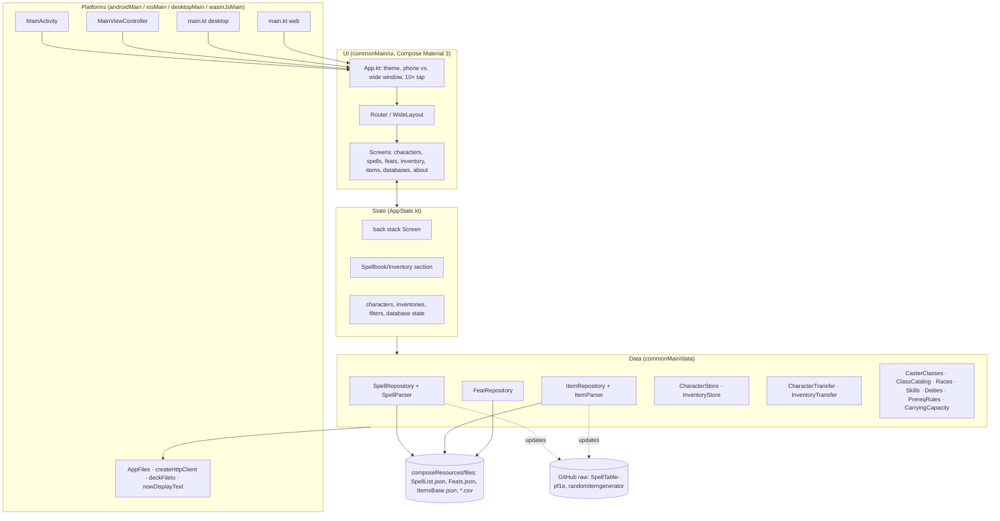

# Architecture

[Čeština](../architecture.md) | **English**

## Overview

A single Kotlin Multiplatform app (`composeApp`). Almost everything – data, logic and UI – lives in `commonMain`
and is shared between Android, iOS, desktop and web. Platform code only handles files, the HTTP client, file dialogs
and the app entry point.



## Stack

| What | Version / library |
|---|---|
| Language, build | Kotlin 2.1.0, Gradle 8.10.2, AGP 8.7.3 |
| UI | Compose Multiplatform 1.7.3, Material 3, `material-icons-core` |
| Data | kotlinx-serialization-json 1.7.3, kotlinx-coroutines 1.9.0 |
| Storage | multiplatform-settings 1.3.0 (characters, inventories) + own `AppFiles` (large files) |
| Network | Ktor 3.0.3 (OkHttp on Android/desktop, Darwin on iOS, Js on the web) |
| Targets | `androidTarget`, `jvm("desktop")`, `iosX64`, `iosArm64`, `iosSimulatorArm64` (framework `ComposeApp`), `wasmJs` (web) |

Versions are in `gradle/libs.versions.toml`.

## Code structure

```
composeApp/src/
  commonMain/kotlin/cz/pfspells/
    App.kt                    theme, phone/wide switch, 10-tap detector, Router
    AppState.kt               all app state + navigation (Screen, Section, filters, ItemDbState, language…)
    Strings.kt                UI texts in English and Czech (Strings, EnStrings, CsStrings, Lang)
    data/
      Model.kt                Spell, Deck (migration and old export only)
      Character.kt            Character (+ companion: ownerId, CompanionKind, size), ClassEntry, Abilities, Alignment, FeatPick, Tracker, Spellbook, CharacterStore (+ deck migration)
      AnimalCompanions.kt     animal companion: CompanionProgression (CRB table), SpeciesCatalog (157 animals), companionMod, withCompanion
      SpeciesTable.kt         GENERATED: 140 further animal companions (d20pfsrd, tools/build_companions.py)
      Familiars.kt            familiars: FamiliarCatalog, FamiliarProgression, familiarBonuses (master's bonus); FamiliarTable.kt GENERATED
      Eidolons.kt             eidolon: progression, forms, evolutions (EvolutionPick), EidolonRepository; EidolonTable.kt GENERATED (tools/build_eidolons.py)
      Equipment.kt            equipped gear: ItemSlot, ItemBonus, stackBonuses (PF1 rules), ItemBonusGuess, loadBonuses, gearMod / gearSkill / gearSave
      Defense.kt              AC / touch / flat-footed (defense, sizeAcMod), HP (maxHp, currentHp)
      Metamagic.kt            slot increase from the metamagic feat text
      StrictMode.kt           strict mode: StrictRules.spellBlock / featBlock → StrictBlock
      CasterClasses.kt        27 casting classes, progressions, CastingKind, slots (LevelSlots, bonusSpells)
      CastingTable.kt         GENERATED: spells per day / known (AoN, tools/build_casting.py)
      ClassInfo.kt            ClassInfo (BAB, saves, HD, class skills, proficiencies), ClassCatalog, Character.stats()
      ClassTable.kt           GENERATED: 49 classes (Foundry, tools/build_classes.py)
      Deities.kt / DeityTable.kt  DeityInfo, DeityCatalog, deityConflicts; GENERATED: 463 deities (AoN, tools/build_deities.py)
      PrereqRules.kt          derived prerequisites: class features, alignment, deity, size, type, HD, proficiencies, spells, domains, racial traits
      Skills.kt               SkillInfo, Skills (26 skills), isClassSkill, skillTotal, skillPoints
      Races.kt                RaceInfo, RaceGroup, RaceCatalog, Character.scores (base + race), race as a feat prerequisite
      RaceTable.kt            GENERATED: 80 races (Foundry, tools/build_races.py)
      RacialTraits.kt         alternate racial traits (RacialTrait, RacialTraitPick, RacialTraits – replaced traits, conflicts)
      RacialTraitTable.kt     GENERATED: default racial traits (AoN, tools/build_racial_traits.py)
      Archetypes.kt           class archetypes (Archetype, ArchetypePick, ArchetypeRepository, Archetypes – conflicts, unchained)
      ArchetypeEffects.kt     archetype mechanics (ArchetypeRules, ClassEntry.archetypeEffect / caster / subclassKind / levelSlots)
      ArchetypeMods.kt        hand-entered effects of known archetypes (ARCHETYPE_MODS)
      Prestige.kt             prestige classes (PrestigeInfo, Prestige – classes to advance, Character.casterLevel, PrestigeRequirements, PrestigeTextRepository)
      PrestigeTable.kt        GENERATED: 118 prestige classes (AoN, tools/build_prestige_classes.py)
      ClassFeatures.kt        FeaturePresets (Smite Evil, Rage…), Character.resources()
      ClassAbilities.kt       subclass powers (SubclassPowers), Foundry formulas (FoundryFormula), hexes and revelations (ClassAbility, AbilityPick, AbilityRules)
      ClassAbilityTable.kt    GENERATED: domain, bloodline, school and blessing powers, patron / spirit / discipline spells (Foundry, tools/build_class_abilities.py)
      SubclassAbilityTable.kt GENERATED: spirit, bloodrager bloodline, discipline and inquisition powers (AoN, tools/build_subclass_abilities.py)
      Subclasses.kt           domains, mysteries, bloodlines, schools, patrons, spirits, disciplines, blessings – SubclassIndex, bonus spells, subdomain → domain table
      Feats.kt                Feat, FeatDatabase, FeatRepository, FeatPrereqs, featSlots
      CharacterTransfer.kt    export/import of characters and feats (+ old decks)
      CustomItems.kt          own item catalog, potions/scrolls/wands from spells (SpellItemKind)
      SpellParser.kt          SpellList.json → Spell
      Repositories.kt         SpellRepository, DeckStore (migration), SpellDatabase
      DeckTransfer.kt         old deck format (import), ImportError
      Items.kt                Item, ItemCategory, ItemDatabase, Inventory, InvEntry, CarryingCapacity
      ItemParser.kt           ItemsBase.json + CSV → Item; CSV parser; decodeText
      ItemRepository.kt       ItemRepository, InventoryStore, InventoryTransfer
      Platform.kt             expect: AppFiles, createHttpClient, deckFileIo, nowDisplayText, currentTimeMillis, trackEvent (Umami, web only)
      AppUpdate.kt            update check from GitHub Releases: AppUpdates (API, version compare, asset pick), expect appUpdater
                              (Android APK + FileProvider, desktop installer downloaded to Downloads, launched and the app closed, web / iOS nothing); APP_VERSION
                              is generated by the Gradle task generateAppVersion from -PappVersion
    ui/
      Theme.kt                Nb.* colors, fonts, PfTheme, modifiers (ruled paper, dashed borders), icons
      Common.kt               shared components + NbScreen (screen skeleton)
      WideLayout.kt           three-column layout
      Journal.kt              "Adventurer's journal" elements: divider tabs (NbIndexTabs, vertical NbIndexTabsVertical), Prepare | Play, animations
                              (rememberRevealProgress, pageTurn, writeIn, staggerIn, reduced motion via LocalReduceMotion), slot circles, margin marks,
                              stamps, index card, torn note, tape, paperclip, page margin, empty states
      DeckListScreen.kt       start screen (tabs), character list, ⋮ menu, new character
      DeckDetailScreen.kt     character detail with journal tabs (Character / Combat / Spells / Inventory / Companions): classes, summary, 3 × 2 abilities, feats, defense, abilities with uses, spells (Prepare | Play), inventory, companions
      ClassPicker.kt          class picker (cards, search, preview, subclass, race and deity for a new character)
      RaceUi.kt               RacePickerDialog, race summary (size, speed, ability modifiers)
      RacialTraitsUi.kt       alternate racial traits (link below the race, picker dialog)
      ArchetypesUi.kt         archetypes (link below the class, picker dialog with text)
      PrestigeUi.kt           prestige classes (controls below the class, detail with requirements, table and features)
      DeityUi.kt              DeityPickerDialog (deity list, custom text), DeityConflictWarning
      SkillsUi.kt             SkillsPanel (character skills: ranks, points, class skills)
      SubclassUi.kt           SubclassFields (subclass fields – shared by the picker and the dialog), SubclassDialog, subclass bonus spells
      FeatScreens.kt          character feats, feat picker and detail (prerequisites, manual confirmation)
      ClassAbilitiesUi.kt     hexes and revelations of a class (count, picker with list and text)
      ResourcesUi.kt          limited-use abilities, custom counters
      DefenseUi.kt            DefensePanel (AC, HP with a damage stepper, defense settings)
      CompanionUi.kt          companions in the character detail, companion sheet header, CompanionDialog
      EquipmentBoard.kt       inventory 2.0: figure with slots, conflict banners, SlotSheet (slot picker)
      EquipmentUi.kt          Equipment section of the entry detail, BonusDialog, gear summary on the character
      SpellBrowserScreen.kt   spell picker for a character's class + compendium
      SpellDetailScreen.kt    spell detail
      InventoryCommon.kt      price/weight formatting, hidden prices, coins, load, tabs
      InventoryScreen.kt      inventory list and detail, sidebar
      ItemScreens.kt          item picker, item/entry detail, custom item
      SpellItemDialog.kt      potion / scroll / wand from a spell
      DeckTransferDialogs.kt  export/import dialogs (characters, feats, inventories)
      DatabaseScreen.kt       database state and updates
      AboutScreen.kt          About & licenses (GPL, Paizo CUP, OGL text)
    composeResources/
      files/                  bundled data (see data.md)
      font/                   Alegreya, Alegreya Sans, IBM Plex Mono, Caveat (handwriting – notes only)
  androidMain/   MainActivity, AndroidManifest, Platform.android.kt, DeckFileIo.android.kt
  desktopMain/   main.kt (window 1360×880, Esc = back), Platform.desktop.kt, DeckFileIo.desktop.kt
  iosMain/       MainViewController.kt, Platform.ios.kt, DeckFileIo.ios.kt
  wasmJsMain/    main.kt (ComposeViewport), Platform.wasmJs.kt (IndexedDB, Ktor Js, file download/pick), resources/index.html
  commonTest/, desktopTest/   tests + PreviewRender (screen previews to PNG)
iosApp/          Xcode project (SwiftUI wrapper around ComposeApp)
tools/build_items.py   builds the bundled item database
tools/build_feats.py, build_casting.py, build_classes.py, build_races.py, build_deities.py   feats (AoN), slot tables (AoN), classes and races (Foundry), deities (AoN)
tools/build_icons.py   app icons from `art/icon.svg`
tools/build_class_abilities.py   subclass powers, hexes and revelations (Foundry)
tools/build_racial_traits.py   default and alternate racial traits (AoN)
tools/build_archetypes.py   class archetypes (AoN)
tools/build_prestige_classes.py   prestige classes (AoN)
tools/build_companions.py   further animal companions and familiars (d20pfsrd)
tools/build_eidolons.py   eidolon – progression, forms, evolutions (d20pfsrd)
```

## State and navigation

The whole app has **one `AppState` object** (created by the platform entry point and passed to `App(state)`).
There is no ViewModel and no navigation library – state lives in Compose `mutableStateOf` / `mutableStateListOf`,
so the UI recomposes on change by itself.

### Back stack
`AppState.stack` is a list of screens (`sealed interface Screen`):

| Screen | What |
|---|---|
| `Decks` | root: start screen (content by `section`) |
| `Compendium`, `Database`, `About` | spell compendium, database management, About & licenses |
| `CharacterDetail(charId)`, `Picker(charId, classId?)` | character, spell picker for one of its classes |
| `SpellDetail(spellId, charId?, classId?)` | spell detail – "aside" |
| `FeatPicker(charId)`, `FeatDetail(featId?, charId?, pick?)` | feat picker, feat detail – "aside" |
| `InventoryDetail(invId)`, `ItemPicker(invId)` | inventory, item picker |
| `ItemDetail(itemId?, invId?, entryId?)` | detail of a database item and/or inventory entry – "aside" |

Operations: `push`, `pop`, `openRoot` (resets the stack to `[Decks, x]` – the desktop sidebar),
`showSpell` / `showItem` (detail; if one is already on top it is **replaced**, so the history does not pile up),
`popMain` (closes the detail and returns to the main screen).

### Phone vs. wide window
`App.kt` measures the width (`BoxWithConstraints`):

- **< 1000 dp → `Router`**: draws only `stack.last()` full screen.
- **≥ 1000 dp → `WideLayout`**: derives the columns from the same stack:
  - *aside* = top of the stack if it `isAside` (SpellDetail / ItemDetail / FeatDetail) → right panel,
  - *main* = the last non-aside screen other than `Decks` → middle column,
  - left panel by `section`: `DeckSidebar` or `InventorySidebar`.

So one stack is enough and resizing the window at runtime works without recomputation.
Screens get a `wide` parameter and draw either a phone bar + floating button, or a large title with inline actions
(`NbScreen` in `Common.kt`).

### Sections
`AppState.section` (`SPELLBOOK` / `INVENTORY`) is switched by the tabs (`SectionTabs`). `switchSection` returns the stack
to the root and, when entering the inventory, triggers lazy loading of the item database.

### UI language (EN / CZ)
- All UI texts are in `Strings.kt`: `interface Strings` and two implementations `EnStrings`, `CsStrings`
  (an interface instead of inheritance – a missing translation is a compile error). Texts with numbers are functions
  (`spells(n)`), Czech has proper plural forms.
- `AppState.lang` is saved to `Settings` (`ui_lang`); without a saved choice the system language is used (`cs`/`sk` → Czech, otherwise English).
- `App` provides `LocalStrings`; composables use `str.xxx`, helper functions outside composables get `Strings` as a parameter.
- The data layer does not build texts: download messages are `UiMessage` (a lambda over `Strings`, so they react to a
  language switch), import errors `DeckImportException(ImportError)`, load `Load`, the export button `SaveAction` – the UI supplies the text.
- The `LangToggle` switch ("EN | CZ") is in the header: on a phone next to the start screen title, in a wide window in the top bar.
- Classes, schools, subschools, spell list names, races and skills are translated by `Strings.className` / `school` /
  `subschool` / `spellListName` / `raceName` / `skillName` (data stays in English, filters work with the original values).
- Data (names and descriptions of spells, feats and items, weapon types, descriptors) stays in the original English,
  as does the Paizo Community Use notice on the About screen (mandatory wording).

### Back
- Android: `onBackPressedDispatcher` → `state.pop()`, closes the app at the root.
- Desktop: the Esc key → `pop()`.
- iOS: the arrow in the UI and swiping from the left edge (`edgeSwipeBack` = true only on iOS).
- Web: Esc → `pop()`; the browser's Back button too – `syncBrowserHistory` (`wasmJsMain/main.kt`) keeps one browser history
  entry per stack level (`pushState` with an index). Shrinking the stack in the app calls `history.go(-n)`,
  a `popstate` with a lower index does `pop()`, Forward goes back again (a closed screen cannot be restored).

## Data and persistence

| What | Where | Format |
|---|---|---|
| Characters | `Settings`, key `characters_v1` (migrated from `decks_v1`) | JSON `List<Character>` |
| Inventories | `Settings`, key `inventories_v1` | JSON `List<Inventory>` |
| Downloaded spells | `AppFiles` `SpellList.json` | original source JSON |
| Downloaded items | `AppFiles` `items_weapons.csv`, `items_ammunition.csv`, `items_magic.csv` | original source CSV |
| Download date | `Settings` `spells_updated_at`, `items_updated_at` | text |
| Favorite spells | `Settings` `favorite_spells_v1` | comma-separated ids |
| Own item catalog | `Settings` `custom_items_v1` | JSON `List<CustomItem>` |
| UI language | `Settings` `ui_lang` | `en` / `cs` |
| Strict mode | `Settings` `strict_mode` | `true` / `false` |

Every change of a character/inventory is saved immediately (`persist()`), there is no "Save".
New fields get default values, so older saved data and exports still load. A breaking schema change needs a new key
version (`characters_v2`…) and a migration (example: `CharacterStore` converts old decks from `decks_v1` and keeps the old key as a backup).

### Storage per platform
`AppFiles` has a `suspend` API because it is asynchronous on the web:

| Platform | `Settings` (characters, inventories) | `AppFiles` (downloaded databases) |
|---|---|---|
| Android | SharedPreferences | `filesDir` |
| iOS | NSUserDefaults | Documents |
| Desktop | Java Preferences | `~/.pfspells/` |
| Web | `localStorage` | IndexedDB `pfspells` / store `files` (localStorage is limited to ~5 MB) |

### Loading databases
- **Spells** load at start (`SpellRepository.load` on `Dispatchers.Default`, ~0.35 s). Until then "Loading spells…" is shown.
- **Feats** (`Feats.json`, bundled only) load **lazily** when a character or the feat picker is first opened (`ensureFeats`).
- **Alternate racial traits** (`RacialTraits.json`) load **lazily** when their dialog opens (`ensureRacialTraits`).
- **Archetypes** (`Archetypes.json`) load **lazily** when the archetype dialog opens (`ensureArchetypes`).
- **Prestige classes** – description and features (`PrestigeClasses.json`) load **lazily** when a prestige class detail opens (`ensurePrestigeTexts`).
- **Eidolon evolutions and subtypes** (`Eidolons.json`) load **lazily** when picking an evolution (`ensureEidolonData`).
- **Hexes and revelations** (`ClassAbilities.json` + spirit hexes `SubclassAbilities.json`) load **lazily** when a character has a witch / shaman / oracle class (`ensureClassAbilities`).
- **Items** load **lazily** – when an inventory, an inventory import or the database screen is opened (`ensureItems`, ~0.3 s).
- Both repositories first try the downloaded version in `AppFiles`; if it is missing or corrupt, they delete it and use the bundled one.
- **Download:** HTTP GET → parse it all (validation) → only then write it to the cache. A failed download breaks nothing.

### Links between data
- A character has a list of classes (`ClassEntry`): each stores `spellId → count`, the subclass (`subclass`, `SubclassSlot`
  keys) and the spells in the domain slot (`bonusSpells`). Spell id = slug of the name (`magic-missile`). After a database
  update a missing spell is reported on the character.
- Character feats (`FeatPick`) carry `featId` (null = custom feat) and a copy of the name, so they work without the feat database.
- Race, deity and skills are stored as ids / names (`race`, `deity`, `skills`); `Character.abilities` are base scores, the
  resulting `scores` include the race.
- An inventory entry (`InvEntry`) carries **its own copy** of the name, category, price, weight and short info; `itemId` is
  only a link to the detail. So an inventory does not depend on the database version and custom items (`itemId = null`) work the same.

## Export / import

`CharacterTransfer` and `InventoryTransfer` turn data into readable JSON with a `format` + `version` header:

```json
{ "format": "pf-spellbook-characters", "version": 1,
  "characters": [ { "name": "Elara", "race": "human", "raceBonus": "INT", "alignment": "NG", "deity": "Nethys",
                    "classes": [ { "class": "wizard", "level": 5,
                                   "subclass": { "school": "evocation", "opposition1": "enchantment", "opposition2": "illusion" },
                                   "spells": [ { "id": "fireball", "name": "Fireball", "count": 1 } ] } ],
                    "abilities": { "int": 16, "str": 10 },
                    "skills": { "spellcraft": 5, "knowledge.arcana": 5 },
                    "feats": [ { "id": "spell-focus", "name": "Spell Focus", "note": "evocation" } ],
                    "inventory": { "name": "Elara", "strength": 10, "items": [ … ] } } ] }
```
```json
{ "format": "pf-spellbook-feats", "version": 1,
  "feats": [ { "id": "power-attack", "name": "Power Attack" }, { "name": "Blessed by Iomedae", "text": "…" } ] }
```
```json
{ "format": "pf-spellbook-inventories", "version": 1,
  "inventories": [ { "name": "Elara", "strength": 10, "coins": { "gp": 124, "sp": 6 },
                     "notes": "…", "items": [ { "name": "Longsword", "item": "weapon-longsword", "category": "WEAPON",
                                                "qty": 1, "price": 15.0, "weight": 4.0, "info": "1d8 / 19-20/×2" } ] } ] }
```

- A character also carries counters (`trackers`), hidden ability presets, confirmed prerequisites (`confirmedPrereqs`),
  extra skill points, defense settings (`hpBonus`, `hpOverride`, `acMisc`), companions (`owner` = the owner's position
  in the file) and optionally the linked inventory including equipped gear (created and linked after import).
  Spells cast in game mode (`castToday`) and damage (`damage`) are not exported.
- Feat import accepts `pf-spellbook-feats` as well as a full character export (it takes the feats from it).
- The old `pf-spellbook-decks` v1 format (`DeckTransfer`) can still be imported – a deck becomes a character with one class.
- Spells and feats are matched by id, then by name; errors are reported by `DeckImportException(ImportError)`.
  The UI is shared: `TextExportDialog` and `TextImportDialog` (preview before confirming).

Saving/opening files is handled by the platform `deckFileIo`:

| Platform | Export | Import from file |
|---|---|---|
| Desktop | AWT `FileDialog` – save `.pfchar.json` / `.pffeats.json` / `.pfinv.json` | `FileDialog` – open |
| Android | system share sheet (text) | `ActivityResultContracts.OpenDocument` |
| iOS | `UIActivityViewController` | – (clipboard only) |
| Web | file download (Blob + `<a download>`) | `<input type=file>` |

## Hidden prices (10 taps)

- `App.kt` has a root `pointerInput` with `awaitFirstDown(pass = Initial, requireUnconsumed = false)` – it sees every touch
  but **does not consume it**, so the rest of the UI works normally.
- `AppState.registerTap(time)` counts taps at most 700 ms apart; on the 10th it toggles `pricesRevealed` and shows a message for 2.2 s.
- `priceLabel(gp, revealed)` returns "??? gp" for a price > `HIDDEN_PRICE_LIMIT` (200 gp); `worthText` hides the total too.
- The state is not saved – after a restart prices are hidden again.

## UI and design

The "Ruled notebook" design (from the author's design in Claude Design):

- `Theme.kt`: colors `Nb.*` (paper #E6D8BF, olive #4E5D2B for main actions, rust #8A4B2A for section titles…),
  `PfTheme` (Material 3 light scheme + typography), fonts via `LocalNbFonts` (serif / sans / mono),
  modifiers `ruledPaper` (lines every 28 dp), `dashedBorder`, `dashedEdge`, `bottomRule`, and stroke icons `NbIcons`
  (SVG paths straight from the design).
- `Common.kt`: `NbScreen`, `SectionHeader` ("*Level 1* - - -"), `CountStepper`, buttons `NbPrimaryButton` / `NbFab` /
  `NbDashedButton` / `NbSquareButton`, `NbTag`, `NbPanel`, `NbFilterChip`, `NbSearchField`, `SimpleDropdown` (height-capped menu).
- UI texts are in `Strings.kt` (EN / CZ); code comments are in Czech.
- On the web Compose has no fallback system fonts – a character missing from the bundled fonts is not shown. So UI texts
  must not use exotic symbols (e.g. "⋮", "⚠" – use icons instead).

## Pathfinder rules in code

- `CasterClasses` – 27 classes, five progression types (9 levels prepared / spontaneous, 6 levels, 4 levels, 4 levels + knacks),
  `maxSpellLevel(level)`, `spellLevelOf(spell)` (with several spell lists the lower level), `canCast`.
- `CarryingCapacity` – carrying capacity by STR (Medium creature, ×4 for every +10 STR), `loadName`.
- `Races`, `Skills`, `Deities`, `PrereqRules` – races, skills, deities and derived feat prerequisites.
- Details and tables are in [data.md](data.md#pf1-rules-in-code).

## Tests

`./gradlew :composeApp:desktopTest`

| Test | Checks |
|---|---|
| `CasterClassTest` | class spell levels against the Core Rulebook tables, cantrips, parser |
| `SlotTableTest` | spells per day and spells known (`CastingTable` from AoN), ability bonus spells |
| `CastTodayTest` | game mode: cast spells and slots, rest |
| `ClassInfoTest` | data of all classes, multiclass BAB and saves, ability modifiers |
| `ClassFeaturesTest` | ability presets (Smite Evil, Rage, Ki…) – uses, hidden and custom |
| `PrereqRulesTest` | class features, alignment, deity (catalog, subdomains, conflicts), size, type, HD, saves, proficiencies, spell kinds, manual confirmation |
| `SkillTest` | class skills, totals, skill points, rank prerequisites (Knowledge, Craft, "or") |
| `ClassAbilitiesTest` | Foundry formulas, domain / subdomain / bloodline / school powers by level, generic fallback power, hex and revelation counts, mysteries, strict mode |
| `RacialTraitsTest` | default traits from AoN, prerequisites with a chosen / replaced trait, human bonus feat and Skilled, conflicts and strict mode |
| `FeatPrereqTest` | splitting and evaluating feat prerequisites, race, racial scores, repeatable feats, feat count |
| `EquipmentTest` | bonus type stacking, bonus guess by name, only equipped and only what fits the slot, slot conflicts |
| `DefenseTest` | AC / touch / flat-footed, max Dex, size, armor check and load penalty, HP (Toughness, rolled, creatures), current HP, metamagic, domain and bloodline powers |
| `AnimalCompanionTest` | animal companion table against "animal" HD, wolf advancement at 7th level, species abilities, specials, suggested level |
| `FamiliarTest`, `EidolonTest` | familiar: progression, master's bonus (skill, save, HP), HD; eidolon: tables, form, saves, evolutions (Ability Increase, Improved Natural Armor, Large), subtype |
| `PrestigeTest` | prestige classes: table, BAB and saves from the table, caster level, classes to advance, bonus feats, requirements |
| `ArchetypesTest`, `ArchetypeEffectsTest` | archetypes: conflicts, unchained, NPC; replaced abilities, subclasses, hexes and bonus feats by level, cantrips, hand-entered effects (no spells, one fewer spell, one domain, Sacred Servant, Insinuator) |
| `StrictModeTest` | strict mode: prepared copies (slots + bonus), known limit, ability and spell level, feat count and prerequisites, animal companion |
| `BundledDataTest` | bundled spells load, every class has spells, unique ids; hexes and revelations (text, formulas, the app's mysteries and domains); alternate racial traits (races, replaced traits) |
| `SubclassTest` | domains, bloodlines, mysteries and schools from `access_ways`, patrons / spirits / bloodrager bloodlines / disciplines from Foundry, blessings and inquisitor domain (deity), bonus spells by level, subclass changes, subdomain → domain |
| `CharacterStoreTest` | migration of old decks to characters |
| `CharacterTransferTest` | character export → import (with and without inventory, race, skills, defense and HP, equipped gear, hexes and revelations, racial traits, archetypes), companions with owner, feats only, old decks, errors |
| `DeckTransferTest` | old deck format: export → import, name matching, rejecting garbage |
| `InventoryLinkTest` | (with `AppState`) character ↔ inventory link – STR on both sides, race size and racial STR, companions and strict mode, equipped gear, damage and rest |
| `ItemDataTest` | bundled items, CSV parser, prices/weights, carrying capacity, hidden prices, inventory export → import |
| `SpellItemsTest` | potion/scroll/wand prices, level limits, min. CL, conversion to the catalog |
| `StringsTest` | Czech plural forms, language codes, texts for all categories/loads/sizes, Czech classes and schools |
| `PreviewRender` | (only with `-Ppreviews=true`) renders screens to PNG for design review |
